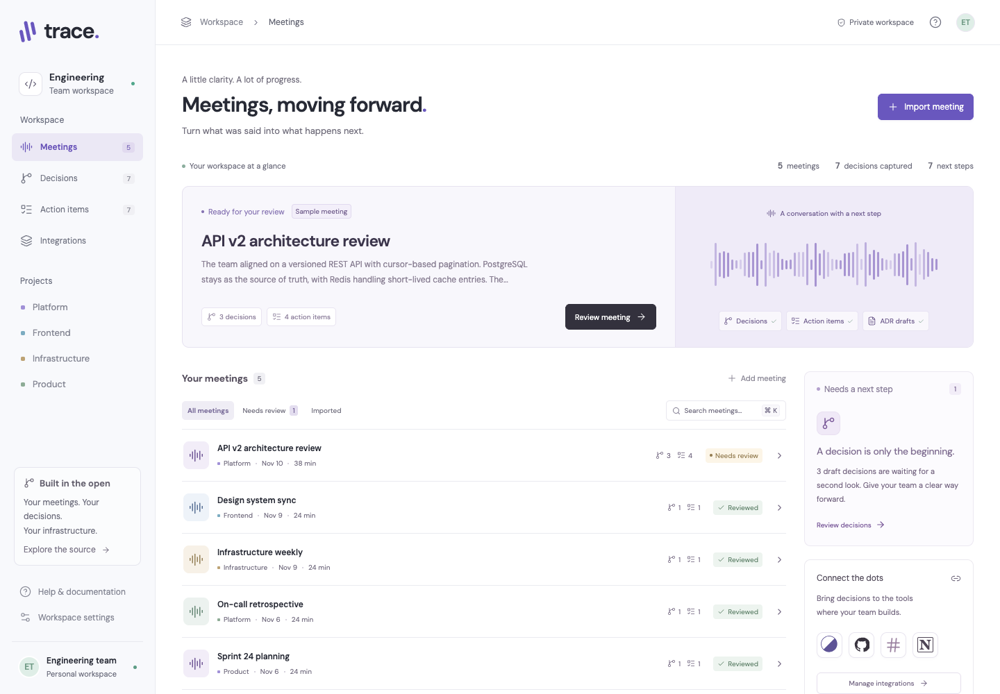

# Trace · Engineering Decision Agent

**Engineering conversations, carried through to execution.**

Trace turns timestamped meeting transcripts into editable architecture decisions, ADR drafts and assigned action items. Review the evidence, correct the wording and owners, then publish approved outputs to Linear, GitHub, Slack or Notion.

[Open the reference app](https://engineering-decision-agent.arunkumar818203.chatgpt.site) · [Recorded walkthrough](docs/demo.mp4) · [Data contract](lib/types.ts) · [Integration guide](docs/integrations.md)



## What works

- Import speaker-labelled text or MeetStream JSON; fetch a transcript using its MeetStream transcript ID.
- Extract explicit agreements and commitments without credentials. Optionally use Claude for contextual extraction.
- Review each decision beside its transcript evidence. Timestamp links open the exact source turn.
- Edit ADR context, rationale and consequences; export Markdown with quotations and evidence links.
- Confirm task owners, priority and due dates. No inferred deadlines.
- Publish approved tasks to **Linear first**, or GitHub; post a Slack summary; create Notion ADR pages.
- Persist meetings and a delivery ledger in Cloudflare D1, scoped to the signed-in user.
- Protect against duplicate imports, concurrent updates, repeated publish clicks and ambiguous downstream failures.
- Search meetings, browse decisions, track action completion and inspect publishing activity on desktop or mobile.

The example meetings are fictional and explicitly labelled. External publishing is disabled for samples. The reference deployment starts private and does not include integration credentials. **Live acceptance with a real meeting and external accounts has not been completed.** The recorded walkthrough demonstrates import, review, editing, evidence, export and the publishing gate with a fictional transcript. Provider writes are covered by mocked contract checks, not claims of live delivery.

## Run locally

Requires Node **22.13+** (Node 24 recommended), npm and Git.

```sh
npm run install:ci
npm run build
node --import ./scripts/sites-env.mjs ./node_modules/wrangler/bin/wrangler.js d1 execute DB --local --config dist/server/wrangler.json --persist-to .wrangler/state --file drizzle/0000_fluffy_black_tom.sql
npm run dev
```

Open the local URL printed by Vinext, normally `http://127.0.0.1:5173`. The local preview has a simulated sign-in: use the Sign in link, or visit `/signin-with-chatgpt?return_to=/`. It uses the local identity `local_seedy` and never creates a production login. Data persists in ignored `.wrangler/state`.

Optional integrations:

```sh
cp .env.example .dev.vars
# Fill only the integrations you want, then restart the dev server.
```

Paste [the demo transcript](docs/demo-transcript.txt) into **Import meeting**, or upload it. All extraction outputs are drafts until reviewed. An AI error preserves the form; you can retry with the Claude option unchecked.

## Deploy

The app uses React 19, Vinext, a Cloudflare Worker and D1. The Sites build integration is retained. `.openai/hosting.json` records this reference deployment; create your own Site identity when deploying a fork.

For Sites, set server runtime secrets through the Sites environment-variable tools, then build and publish. D1 migrations are applied by the publishing pipeline. See [deployment and operations](docs/operations.md) for an independent Cloudflare deployment and the authentication boundary.

## Verify

```sh
npm run typecheck
npm test
npm run build
# With npm run dev running in a separate terminal:
npm run test:api
```

Core tests cover parsing, duplicate commitments, evidence/owner/date validation, ADR exports, approval boundaries, a twelve-worker concurrent SQLite claim, Linear assignment and GraphQL error handling, and untrusted AI output. API checks cover login, deduplicated imports, optimistic concurrency, invalid evidence, cross-origin rejection and the sample publishing guard. Browser QA covers the import/review/edit/export flow, timestamp navigation, keyboard dialogs, mobile navigation and horizontal overflow at 390px.

## Data flow and reliability

`Transcript → validated segments → extracted drafts → human review → delivery claim → external tool`

The runtime contract is [lib/types.ts](lib/types.ts), including decisions, action items, meetings and transcript segments. Evidence IDs must refer to existing segments; assigned owners must be named speakers. Dates must be real ISO calendar dates. Source transcripts are immutable during review.

A normalized transcript fingerprint deduplicates repeated imports for each user. Meeting revisions reject stale saves with HTTP 409. Before any external write, a unique D1 ledger entry atomically claims `(owner, meeting, item, destination)`. Repeated and concurrent requests skip existing claims. An interrupted or ambiguous attempt stays pending or uncertain and is **never automatically retried**. Review the destination and reconcile manually; see [operations](docs/operations.md). This deliberately favors avoiding duplicate work over silently retrying a possibly successful write.

Linear and GitHub require an explicit speaker-to-account mapping. Trace rejects the whole publish preflight if an approved task has no owner mapping. Destination changes do not cause previous items to be recreated. A summary is delivered once per meeting and destination; edits after publishing stay in Trace, so update existing external records manually.

## Scope

This is a deployable reference app, not a calendar scheduler or a general workflow engine. It imports completed transcripts; it does not dispatch recording bots, accept webhooks, or stream live meetings. Jira is not included: this implementation uses Linear and GitHub. Trace uses per-user workspaces; collaborative organizations, invitation flows, provider OAuth and bidirectional task sync are outside this reference.

## References and acknowledgements

The workflow was informed by MeetStream’s [Companion](https://github.com/meetstream-ai/companion), [TypeScript SDK](https://github.com/meetstream-ai/meetstream-node) and [Labs](https://github.com/meetstream-ai/labs). MeetStream’s SDK documents the transcript-ID lookup and the `transcript`, `speaker`, `start_time` and `end_time` wire fields used here.

Protocol references: [MeetStream transcription](https://docs.meetstream.ai/guides/transcription-recordings/post-call-transcription), [Linear GraphQL](https://linear.app/developers/graphql), [GitHub issues](https://docs.github.com/en/rest/issues/issues#create-an-issue), [Slack incoming webhooks](https://docs.slack.dev/messaging/sending-messages-using-incoming-webhooks/), [Notion page creation](https://developers.notion.com/reference/post-page), [Claude Messages](https://platform.claude.com/docs/en/api/messages/create), and [Claude model IDs](https://platform.claude.com/docs/en/models/overview).

DM Sans is distributed under its [SIL Open Font License](public/fonts/OFL.txt). The retained Sites starter infrastructure includes its own license notices. Application code is MIT licensed.
